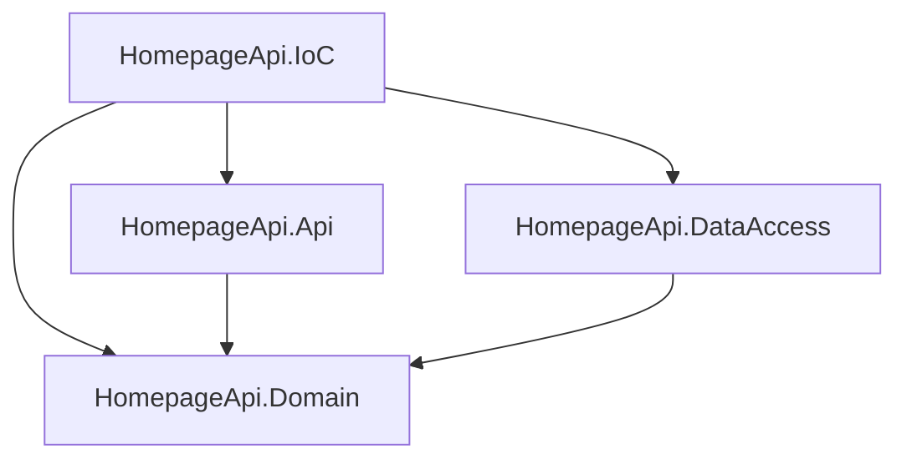

# homepage-api

The API behind the [fztgreen.dev](https://fztgreen.dev) homepage: a .NET 10 Web API built with **Clean Architecture** (Onion), **CQRS**, and a **centralized IoC** composition root, developed with strict **Test Driven Development**. It follows the DotNetExample conventions described in [CONTRIBUTING.md](CONTRIBUTING.md) and [TESTING.md](TESTING.md).

Today it has one feature, **Feedback**: `POST /feedback` takes a name, a message and a respond-by date and stores them through the `StoreRequest` stored procedure. The SQL wrapper behind it, `DapperSqlDatabaseWrapper`, is still a stub that throws `NotImplementedException`, because no database has been chosen yet. The endpoint returns 500 until that's implemented.

## Getting Started

Prerequisites: a .NET 11 SDK in the 11.0.1xx feature band, plus the .NET 10 runtime. The projects target `net10.0` (long-term support) and are built with the newer SDK. [`global.json`](global.json) pins the SDK with `rollForward: latestPatch`: any 11.0.1xx patch works, but another feature band or major version is rejected, so every machine builds with the same compiler and analyzers. If `dotnet` reports "A compatible .NET SDK was not found", install the SDK with `winget install Microsoft.DotNet.SDK.11` (current Visual Studio releases include it).

```bash
dotnet build HomepageApi.slnx
dotnet test HomepageApi.slnx
dotnet run --project HomepageApi.IoC
```

The executable is the **IoC** project, not the Api project. Swagger UI is enabled in the Development environment. Sample requests are in `HomepageApi.IoC/HomepageApi.IoC.http`.

CORS allows `https://fztgreen.dev` in production and the `localhost` policy in Development (configured in `HomepageApi.IoC/Program.cs`).

## Continuous Integration

[`.github/workflows/build.yml`](.github/workflows/build.yml) runs on every pull request, on every push to `main`, and weekly:

- **`unit`** builds the solution (style rules and `TreatWarningsAsErrors` included) and runs `HomepageApi.Tests`, the controller and architecture tests.
- **`integration`** runs `HomepageApi.IntegrationTests`, the wrapper contract tests, on a runner with Docker.

Both jobs use the SDK pinned in `global.json`, so the analyzers behave the same as they do locally. The weekly run catches newly published NuGet security advisories, which `TreatWarningsAsErrors` turns into build errors, before they break an unrelated pull request.

**Make both jobs required status checks** in the `main` branch protection, so a red build can't be merged. The style rules and architecture tests only protect `main` if something runs them on every change.

## Architecture

Dependencies flow strictly inward toward the Domain.



| Project | Role | May reference |
|---|---|---|
| `HomepageApi.Domain` | Entities, value objects, logic, Commands, Queries, repository interfaces | Nothing |
| `HomepageApi.DataAccess` | Repository implementations, infrastructure wrappers | Domain |
| `HomepageApi.Api` | Controllers, DTOs, `ApiConfiguration.cs` (no `Program.cs`) | Domain |
| `HomepageApi.IoC` | `Program.cs` entry point, `RegisterDependencies.cs` DI wiring | Api, DataAccess, Domain |
| `HomepageApi.Tests` | MSTest unit tests (API tests over `WebApplicationFactory` with mocked wrappers) and architecture tests | Everything |
| `HomepageApi.IntegrationTests` | Wrapper contract tests against real dependencies | DataAccess |

### Directory Layout

```text
homepage-api/
├── global.json                 # Pins the .NET SDK feature band
├── Directory.Build.props       # Shared build settings for every project
├── .editorconfig               # Style rules, enforced during build
├── .github/                    # CODEOWNERS, workflows/build.yml
├── HomepageApi.Api/
│   ├── Controllers/            # FeedbackController.cs (flat: one controller per feature)
│   ├── Models/Feedback/        # FeedbackRequest
│   └── ApiConfiguration.cs
├── HomepageApi.DataAccess/
│   ├── Feedback/               # FeedbackRepository, StoreFeedbackParameters
│   └── Wrappers/               # ISqlDatabaseWrapper, DapperSqlDatabaseWrapper (flat)
├── HomepageApi.Domain/
│   ├── Commands/Feedback/      # StoreFeedback
│   ├── DataAccess/Feedback/    # IFeedbackRepository
│   └── Entities/Feedback/      # FeedbackSubmission
├── HomepageApi.IoC/            # Program.cs, RegisterDependencies.cs, appsettings
├── HomepageApi.Tests/
│   ├── Api/FeedbackControllerTests/  # One file per method: CreateShould.cs
│   └── Architecture/                 # Convention rules: LayersShould.cs, HandlersShould.cs, …
└── HomepageApi.IntegrationTests/
    └── Architecture/                 # WrappersShould.cs: every wrapper has an integration test
```

Code is grouped into a folder per feature inside each layer, with namespaces matching the folders. See [Feature Folders](CONTRIBUTING.md#feature-folders).

## Technology

- .NET 10 target (`net10.0`), built with the .NET 11 SDK; C# 14, the language version for `net10.0`; nullable reference types and implicit usings enabled
- `TreatWarningsAsErrors` and build-time `.editorconfig` enforcement in every project, via `Directory.Build.props`
- MSTest (`MSTest.Sdk`), NSubstitute, FluentAssertions, RandomTestValues
- ArchUnitNET for architecture tests
- Swashbuckle for Swagger
- `System.Text.Json` for JSON and Dapper for SQL (see [Preferred Libraries](CONTRIBUTING.md#preferred-libraries))

## Documentation

- [CONTRIBUTING.md](CONTRIBUTING.md): architecture rules, design patterns, and the development workflow
- [TESTING.md](TESTING.md): TDD protocol, coverage requirements, mocking rules, and test conventions
- [REVIEW.md](REVIEW.md): code review checklist
- [CLAUDE.md](CLAUDE.md) / [AGENTS.md](AGENTS.md): instructions for AI coding agents
